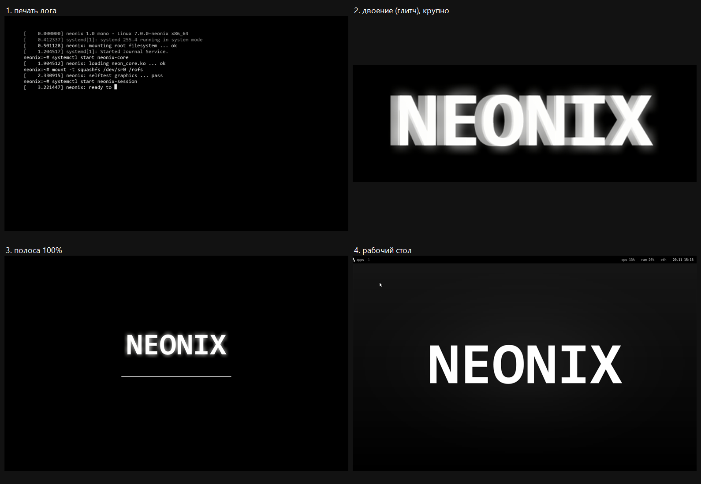
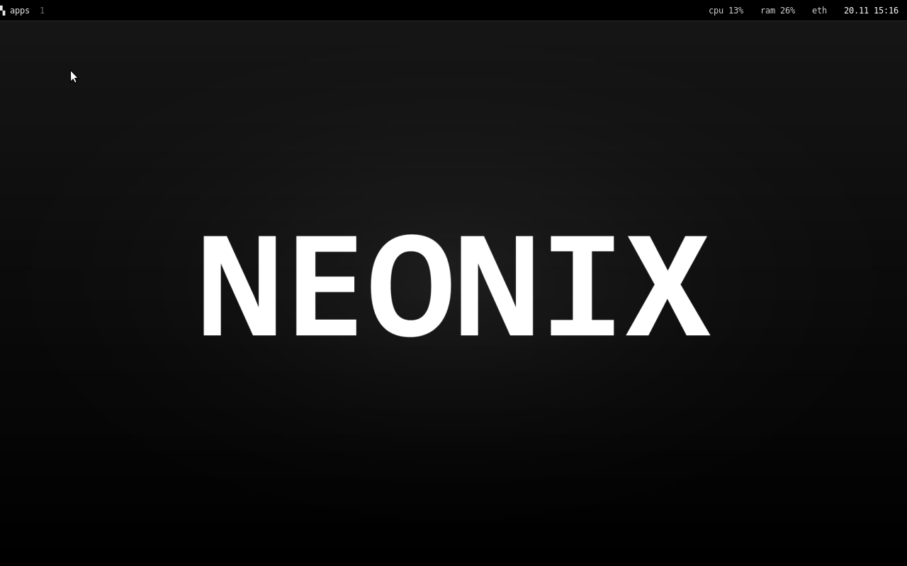
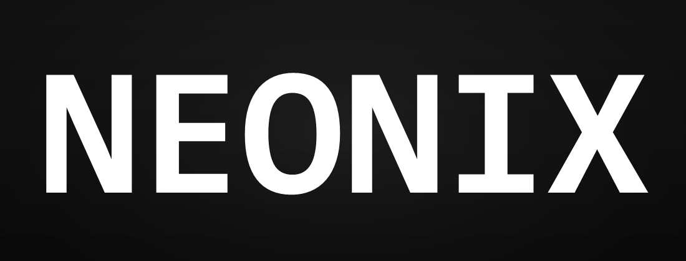

# Neonix — монохромный ремикс Ubuntu 24.04

Live-система на базе Ubuntu 24.04: чёрно-белая заставка с настоящим логом загрузки, минималистичный рабочий стол на **Hyprland** (реальное железо) / **sway** (ВМ), почти пустые обои с логотипом.



## Что нового в 1.1

- **Заставка переписана**: 10 строк реального лога (ядро, systemd, команды с приглашением `neonix:~#`), посимвольная печать ~6–8 с, затем логотип `NEONIX` со свечением и периодическим «двоением», полоса прогресса доезжает до 100%.
- **Рабочий стол** переехал с XFCE на **sway + waybar** (Hyprland на железе): кнопка `▚ apps`, рабочие столы, cpu/ram/eth/часы.
- **Обои** рисуются заново (текст в финальном размере — без мыла), плюс смена обоев на ходу.
- Автозапуск сессии через systemd (`neonix-session.service`), исправлено отсутствие пользователя `ubuntu` в live-server ISO.

## Скриншоты

| Загрузка: лог → двоение → полоса | Рабочий стол |
|---|---|
|  |  |

Обои вблизи, кроп 1:1:



## Скачать

Релизы: <https://github.com/pauk131212/neonix/releases>

**Neonix 1.1** — `neonix-personal-1.1-amd64.iso`, 5 518 796 800 байт, SHA-256:

```
93b2174a1105b6b70718d7c819cf41e1c9eaab08f35c36b513ad21efbfbe6fb5
```

GitHub не принимает файлы больше 2 ГиБ, поэтому образ порезан на три части. Скачать все три и склеить:

```powershell
# Windows
copy /b neonix-1.1-amd64.iso.part1+neonix-1.1-amd64.iso.part2+neonix-1.1-amd64.iso.part3 neonix-personal-1.1-amd64.iso
Get-FileHash .\neonix-personal-1.1-amd64.iso -Algorithm SHA256
```

```bash
# Linux / macOS
cat neonix-1.1-amd64.iso.part* > neonix-personal-1.1-amd64.iso
sha256sum neonix-personal-1.1-amd64.iso
```

Готовые скрипты склейки: `tools/join.ps1` и `tools/join.sh` (кладутся рядом с частями).

Запись на флешку (от 8 ГБ): Rufus/balenaEtcher в режиме «DD», либо
`sudo dd if=neonix-personal-1.1-amd64.iso of=/dev/sdX bs=8M status=progress oflag=sync`.

Загрузка проверена в BIOS/Legacy (VirtualBox); UEFI отдельно не тестировалась.

## Загрузка и вход

1. Заставка → рабочий стол (в ВМ ~70–90 секунд).
2. Вход автоматический: пользователь `ubuntu`, **пароль пустой**.
3. Если графическая сессия не поднялась — вход через ttyS0 тем же пользователем.
4. Система **live**: изменения не сохраняются после перезагрузки.

## Управление

`Win` — клавиша Windows.

| Клавиши | Действие |
|---|---|
| `Win+Enter` | терминал (foot) |
| `Win+D`, `Win+Tab` | меню приложений (fuzzel) |
| `Win+E` | файлы (thunar) |
| `Win+Q` | закрыть окно |
| `Win+Shift+W` | выбрать обои из `~/Pictures` |
| `Win+Shift+B` | вернуть стандартные обои |
| `Win+1..6` | рабочие столы |
| `Win+F` | полный экран |
| `Win+Shift+E` | выйти из сессии |

```bash
neonix-wallpaper <файл>   # свои обои (запомнится до перезагрузки)
neonix-wallpaper --pick   # выбрать из ~/Pictures и системных
neonix-wallpaper --default
```

## Проверка образа в VirtualBox

Образ проверялся в VirtualBox: 2 ГБ RAM, 1 CPU, 1280x800, контроллер **VMSVGA**.
С `vboxsvga` гость иногда встаёт на смене видеорежима (`watchdog: BUG: soft lockup`) — выглядит как чёрный экран.

## Сборка

База — Ubuntu 24.04 live-server, сборка через [Cubic](https://github.com/PJ-Singh-001/Cubic): в chroot копируются тема plymouth (и внутрь initrd), конфиги сессии, юнит `neonix-session.service` и пользователь `ubuntu`.

```bash
SRC=/media/sf_work/neonix bash scripts/13-run-all.sh
```

- `scripts/08-fix-user.sh` — пользователь `ubuntu` (в live-server ISO его нет — главная причина чёрного экрана).
- `scripts/09-apply-theme.sh` — тема plymouth в chroot + патч initrd.
- `scripts/10-apply-tweaks.sh` — sway/waybar/скрипт сессии/обои/юнит.
- `scripts/11-patch-initrd.sh` — DRM-модули и тема внутрь initrd (смещение zstd-потока в `OFFSET`).
- `scripts/12-build-final.sh` — mksquashfs + xorriso.
- `scripts/13-run-all.sh` — всё подряд.

Пути по умолчанию (`/media/sf_work`, `/home/builder/cubic-project`) — из моей среды сборки (VirtualBox + общая папка); переопределяются переменными `SRC` и `P`.

Генераторы графики (PowerShell, Windows, шрифт Consolas):

- `branding/neonix/generators/make-splash.ps1` — строки лога, маска печати, логотип, полоса, глитч → `branding/neonix/plymouth/neonix/assets/*` и `neonix.script`.
- `branding/neonix/generators/make-logo2.ps1` — резкий `logo.png` + свечение `logo_glow.png`.
- `branding/neonix/generators/make-wallpaper.ps1` — обои (текст в финальном размере).
- `branding/neonix/generators/make-glow.ps1` — вспомогательное размытие.

## Что где лежит

```
session/                              sway/waybar/Hyprland, запуск сессии, смена обоев
branding/neonix/plymouth/neonix/      тема plymouth (скрипт + assets)
branding/neonix/generators/           генераторы графики (PowerShell)
branding/neonix/assets/               логотип, обои, брендинг 1.0
branding/neonix/{grub,lightdm,xfce}/  брендинг 1.0 (XFCE)
scripts/                              сборка в chroot и упаковка ISO
docs/                                 план, чек-лист, скриншоты
tools/                                склейка частей релиза
```

## История

- **1.0** — XFCE, «код» на загрузке, светлая кибер-эстетика. Релиз `v1.0`.
- **1.1** — монохром, новая заставка, Hyprland/sway, смена обоев.

Neonix — неофициальный ремикс Ubuntu, не связан с Canonical. Лицензия — MIT (`LICENSE`), пакеты Ubuntu остаются под своими лицензиями.
